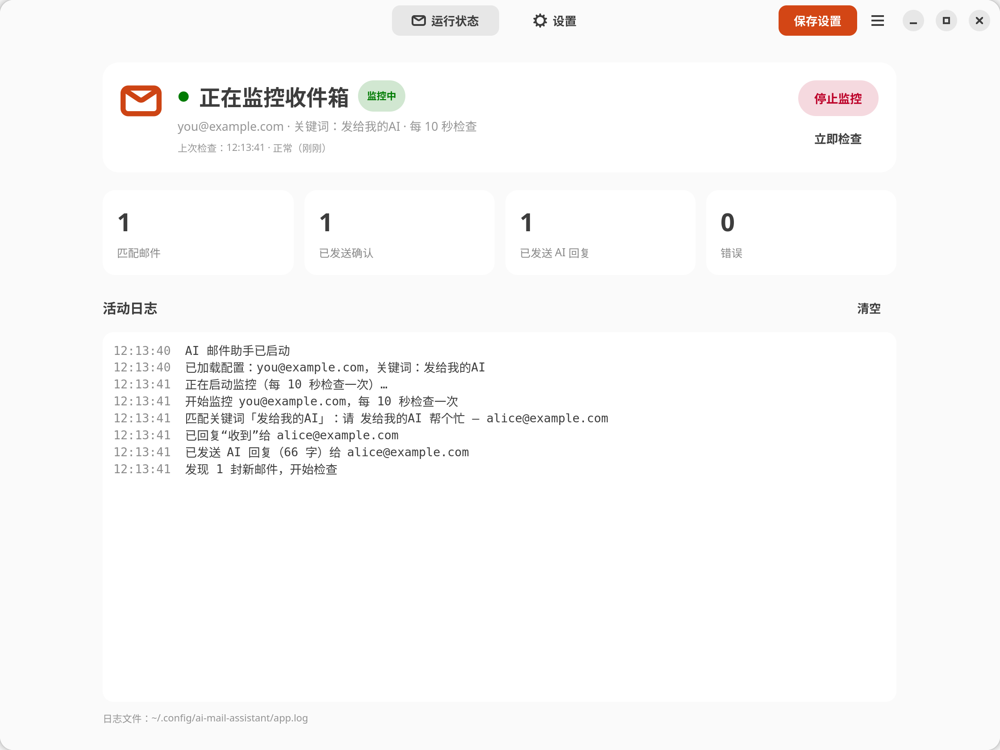
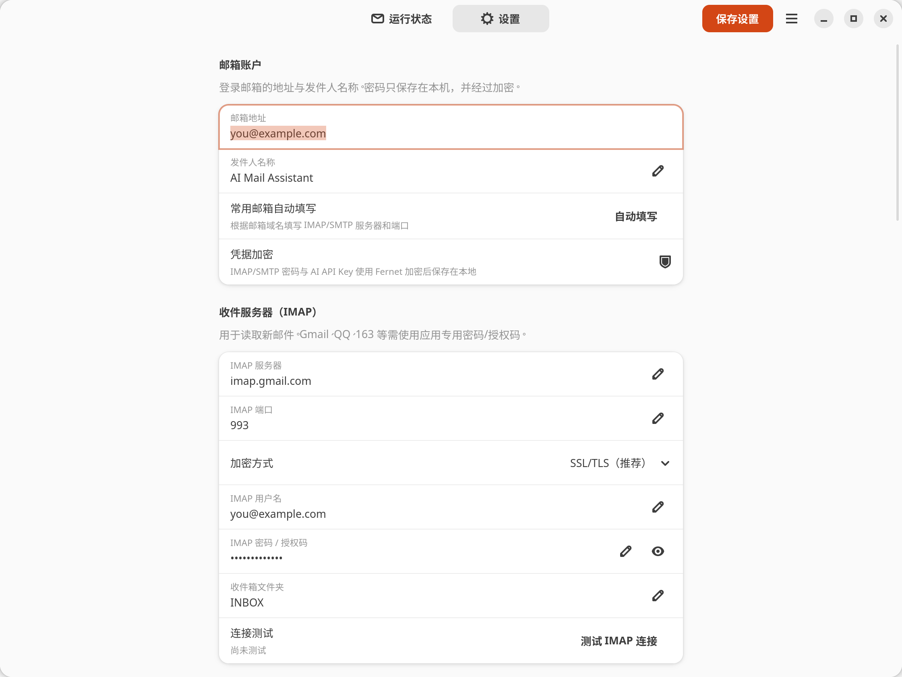
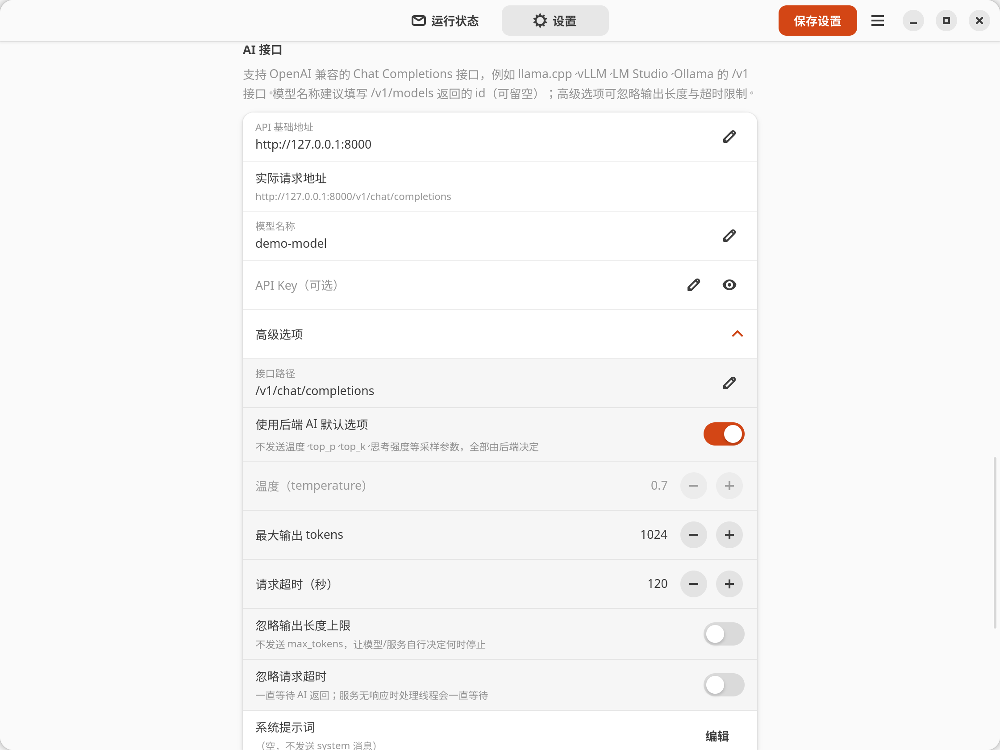

# AI 邮件助手

**AI Mail Assistant** 是一个本地运行的 AI 邮件自动回复桌面应用：收到包含关键词的邮件后，先立即回复“收到”，再把邮件正文交给本地 AI，最后把 AI 输出作为邮件回复发回给发件人。

版本：**1.5.0** · Python 3.10+ · GTK 4 / libadwaita · MIT License  
作者：**Bruce** · 个人主页：[bruce-fudan.github.io](https://bruce-fudan.github.io)



*运行状态：关键词匹配、确认回复、AI 回复统计和活动日志*



*邮箱账户、IMAP/SMTP、触发规则、AI 接口和本地加密说明*

---

## 功能

- **桌面 UI**：GTK 4 / libadwaita 图形界面，配置、测试、监控、日志一屏完成。
- **关键词触发**：支持多个关键词（逗号分隔），可限定只匹配主题、正文或两者，忽略大小写。
- **自动确认**：匹配后立即回复可自定义的“收到”，再调用 AI。
- **本地 AI 接口**：兼容 OpenAI `chat/completions` 的本地服务；可配置基础地址、模型、API Key、接口路径、温度、超时等。
- **后端默认选项**：可让 AI 后端自行决定采样参数，不发送 `temperature`、`top_p`、`top_k`、思考强度等字段。
- **不注入隐藏 Prompt**：系统提示词原样发送；用户消息就是邮件正文；程序不添加、修改或补全 Prompt。
- **指定回复格式**：AI 原始输出会被包装成：

  ```text
  Dear <发件人邮箱>,

  <AI 原始输出>

  Yours,
  <模型名称>
  ```

- **凭据加密**：IMAP/SMTP 密码与 AI API Key 使用 Fernet 加密保存，权限 `600`。
- **防回环**：默认忽略自动提交、邮件列表、退信地址、本应用生成的回复和本账号自己发出的邮件；发送 RFC 3834 自动回复头。把本账号加入白名单可自测。
- **白名单**：可只响应指定邮箱或域名；把本账号加入白名单可进行自测。
- **去重与恢复**：记录 UID 水位、UIDVALIDITY 和 Message-ID，避免重复回复；历史未读邮件可分批处理。
- **连接测试**：IMAP、SMTP、AI 三个测试按钮，不修改当前配置。
- **可离线测试**：内置 OpenAI 兼容 mock AI 服务，没有模型也能跑通完整链路。

## 工作流程

```text
IMAP 轮询
  └─ 发现新邮件
       └─ 关键词匹配 + 白名单/自动回复过滤
            └─ 立即发送确认邮件（默认“收到”）
                 └─ 把邮件正文作为 user 消息发给 AI
                      └─ 收到 AI 输出
                           └─ 包装成 Dear / Yours 邮件并 SMTP 发回
```

默认只处理启动之后到达的新邮件；重启后会继续处理停机期间的新邮件。可在“触发规则”中开启“首次启动时处理已有未读邮件”。

## 运行环境

- Linux 桌面（Wayland / X11）
- Python 3.10+
- GTK 4 + libadwaita 1.5+ + PyGObject
- `cryptography`, `requests`

已在 Ubuntu 26.04、Python 3.14、GTK 4 / libadwaita 1.9 下测试。

## 安装

### Ubuntu / Debian

```bash
sudo apt update
sudo apt install -y python3-gi gir1.2-gtk-4.0 gir1.2-adw-1 python3-venv
```

如果系统 Python 已经安装了 `cryptography` 和 `requests`：

```bash
git clone <your-repo-url>
cd ai-mail-assistant
python3 main.py
```

否则建议使用带系统包的虚拟环境，以便继续使用系统的 GTK 绑定：

```bash
git clone <your-repo-url>
cd ai-mail-assistant
python3 -m venv --system-site-packages .venv
.venv/bin/pip install -r requirements.txt
.venv/bin/python main.py
```

也可以直接运行：

```bash
chmod +x run.sh
./run.sh
```

> 纯 SSH、无图形显示的环境无法启动 GTK 窗口。

## 快速开始

1. 启动应用。
2. 在“设置”中填写：
   - 邮箱地址、发件人名称；
   - IMAP 服务器、端口、加密方式、用户名、密码/授权码；
   - SMTP 服务器、端口、加密方式、用户名、密码/授权码；
   - 触发关键词，例如 `发给我的AI`；
   - AI API 基础地址，例如 `http://127.0.0.1:8000`；
   - 模型名称（按你的 AI 服务填写，可留空）。
3. 点击 **测试 IMAP 连接**、**测试 SMTP 连接**、**测试 AI 接口** 验证配置。
4. 点击右上角 **保存设置**，回到“运行状态”，点击 **开始监控**。
5. 给监控邮箱发送一封包含关键词的新邮件。几秒内会收到“收到”，随后收到 AI 回复。

## 常用邮箱设置

| 邮箱 | IMAP | SMTP | 备注 |
| --- | --- | --- | --- |
| Gmail | `imap.gmail.com:993` SSL | `smtp.gmail.com:465` SSL | 建议开启两步验证并使用“应用专用密码” |
| QQ 邮箱 | `imap.qq.com:993` SSL | `smtp.qq.com:465` SSL | 在邮箱设置中开启 IMAP/SMTP，使用授权码 |
| 163 / 126 | `imap.163.com:993` SSL | `smtp.163.com:465` SSL | 使用客户端授权码；程序会自动发送 IMAP ID |
| Outlook | `outlook.office365.com:993` SSL | `smtp.office365.com:587` STARTTLS | 部分账号要求 OAuth，不支持时请换用其他邮箱 |

应用内置了这些域名的“自动填写服务器”按钮。**网页登录密码通常不能用于 IMAP/SMTP**，请使用授权码或应用专用密码。

## 接入本地 AI

应用假设 AI 服务兼容 OpenAI Chat Completions：

```http
POST http://127.0.0.1:8000/v1/chat/completions
Content-Type: application/json

{
  "model": "你的模型名",
  "messages": [
    {"role": "system", "content": "<你在设置里填写的系统提示词>"},
    {"role": "user", "content": "<邮件正文>"}
  ],
  "stream": false
}
```

返回：

```json
{"choices": [{"message": {"content": "AI 的回答"}}]}
```

设置页填写“API 基础地址”即可，程序会自动拼接 `/v1/chat/completions`；服务路径不同可在“高级选项”修改“接口路径”，也支持直接填写完整 URL。

### AI 输入与回复格式

- **system 消息**：完全使用你在“系统提示词”里填写的内容，原样发送；留空则不发送 system 消息。程序不注入任何默认 Prompt。
- **user 消息**：邮件解析后的纯文本正文，不附加任何说明或模板；HTML 邮件会先转换成纯文本。程序不会额外拼接 Prompt。
- **回复邮件**：AI 原始输出 + `Dear <发件人邮箱>` 和 `Yours, <模型名称>`。模型名称优先取 AI 响应中的 `model`，其次取设置中的模型名称，都为空时显示 `AI`。
- **立即确认邮件**：只发送“立即回复内容”中配置的短文本（默认“收到”），不添加其他内容。

### 高级 AI 选项

- **使用后端 AI 默认选项**：不发送 `temperature`、`top_p`、`top_k`、思考强度等采样参数，由后端决定默认值。
- **忽略输出长度上限**：不发送 `max_tokens`。
- **忽略请求超时**：HTTP 请求不设置超时，一直等待 AI 返回（服务无响应时处理线程会一直等待）。



*AI 接口与高级选项（截图使用 demo-model 和示例地址）*

### 没有模型时测试

```bash
python3 tools/mock_ai_server.py --port 8000
```

然后在设置中把 AI 地址填为 `http://127.0.0.1:8000`，点击“测试 AI 接口”。

## 安全与隐私

- **无遥测**：程序不收集、不上传统计数据，不会连接除你配置的 IMAP、SMTP、AI 服务之外的地址。
- **凭据加密**：密码和 API Key 使用 Fernet（AES-128-CBC + HMAC）加密后保存。`secret.key` 与 `settings.json` 位于同一数据目录，权限均为 `600`；数据目录权限 `700`。
- **数据目录**：Linux 默认 `~/.config/ai-mail-assistant/`：
  - `settings.json`：配置（密码/API Key 为密文）
  - `secret.key`：本地加密密钥
  - `state.json`：UID 水位和已处理 Message-ID
  - `app.log`：运行日志（不含密码，但会包含邮件主题/发件人）
- 可用 `AI_MAIL_HOME` 环境变量或 `--data-dir` 指定其他目录。
- **加密边界**：如同目录下的密钥和密文都能被同一个恶意程序读取，加密无法抵御已控制你用户目录的攻击者。它主要用于避免配置被误读、误同步或明文泄露。
- **AI 隐私**：邮件正文会发送到你填写的 AI 地址；如果地址不是本机，请自行评估内容外发风险并使用 HTTPS。
- **自动回复安全**：关键词相当于触发口令。公开邮箱建议使用不常见关键词并开启发件人白名单，避免被陌生人触发大量 AI 调用。
- **发布仓库**：不包含用户配置、密钥、日志、构建缓存或真实邮箱地址；截图使用 `example.com` 和 mock 数据。

## 常见问题

### 自己发给自己的测试邮件没有收到“收到”

程序默认跳过“发件人是本账号自己”的邮件，避免自动回复死循环。要自测，请把本账号地址加入“发件人白名单”。程序会正常处理原始邮件，但会忽略自己生成的确认/AI 回复（通过 `X-AI-Mail-Assistant` 和 `Auto-Submitted` 头识别），不会循环。

自动回复只会发给原始发件人（`From`），不会发给邮件的 `To` 地址或转发地址。

### 日志里显示“未匹配关键词”

检查“匹配范围”：例如当前是“仅主题”，关键词只写在正文里不会触发。UID 水位之前的旧邮件不会重新扫描，请发送新邮件测试。

### 收到了“收到”但没有 AI 回复

查看活动日志中的 AI 错误；再到“设置 → AI 接口 → 连接测试”确认接口可用。AI 失败不会重复发送确认邮件。


## 配置项说明

| 配置 | 说明 |
| --- | --- |
| 匹配范围 | 主题、正文或两者；关键词不区分大小写 |
| 检查间隔 | 5–300 秒，默认 10 秒 |
| 忽略自动回复/批量邮件 | 默认开启，避免自动回复循环 |
| 首次启动处理已有未读 | 默认关闭；开启后按批次处理历史未读 |
| 允许的发件人 | 留空允许所有人；支持 `a@b.com`、`@b.com`、`b.com`、`*@b.com`。把本账号加入可自测 |
| 立即回复内容 | 收到关键词邮件后立即发送的确认文本，默认“收到” |
| AI 失败时通知发件人 | 默认关闭；开启后发送失败提示 |
| 使用后端 AI 默认选项 | 不发送 temperature 等采样参数 |
| 忽略输出长度上限 | 不发送 max_tokens |
| 忽略请求超时 | HTTP 请求不设超时 |

## 开发与测试

```bash
# 全部单元测试 + 集成测试（本地假 IMAP/SMTP/AI 服务）
python3 -m unittest discover -s tests -t . -v
```

测试覆盖：

- Fernet 加密/解密、设置文件不落明文、文件权限、损坏密钥提示；
- MIME 解析、HTML 正文降级、关键词匹配、自动提交忽略、白名单、Reply-To 校验；
- 真实 `imaplib` 协议交互（假 IMAP 服务）；
- 真实 `smtplib` 投递（假 SMTP 服务）；
- OpenAI 兼容客户端成功、错误、重试、后端默认参数；
- 监控流程：确认回复、AI 回复、去重、UIDVALIDITY 变化、历史未读队列、失败处理；
- 端到端：真实 IMAP + SMTP + AI 客户端串起完整自动回复链路。

当前测试数量：**59**。

### 目录结构

```text
main.py                    入口
run.sh                     启动脚本
aimail/
  cli.py                   命令行
  config.py                配置模型、校验与持久化
  secure_store.py          Fernet 密钥与密文
  ai_client.py             OpenAI 兼容客户端
  mailer.py                IMAP/SMTP、MIME、回复格式
  monitor.py               轮询线程、UID 水位与自动回复流程
  ui/                      GTK4 / libadwaita 界面
tools/
  mock_ai_server.py        本地 mock OpenAI 服务
  ui_preview.py            开发用离屏截图
tests/                     单元/集成测试
assets/                    README 截图（示例数据）
```

## 已知限制

- 仅支持密码/授权码认证，不支持 OAuth2。
- AI 接口需兼容 OpenAI Chat Completions；其他协议可在 `ai_client.py` 中扩展。
- 当前 AI 回复以**纯文本邮件**发送，Markdown/LaTeX 的 HTML 渲染尚未实现。
- 自动回复在 AI 请求期间占用监控线程；超时可调整或关闭。
- 应用退出后不再监控；需要保持应用运行。
- 为避免重复回复，发出“收到”后会先把邮件标记为已处理；若恰好在 AI 请求期间强制退出，这封已确认邮件不会自动补发 AI 答案。

## 贡献

欢迎提交 Issue、Pull Request。提交前请运行完整测试，并确保不要提交任何真实邮箱配置、日志、密钥或构建产物。

## 作者

**Bruce**

- 个人主页：[https://bruce-fudan.github.io](https://bruce-fudan.github.io)

## License

MIT
